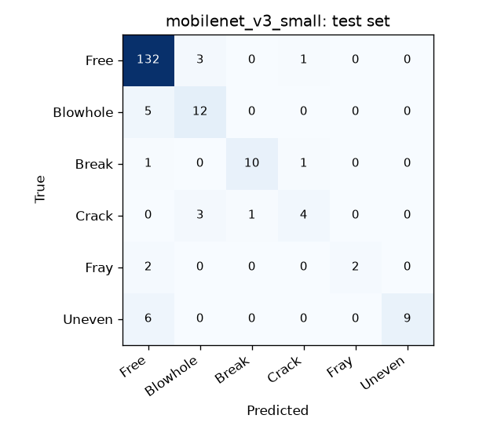
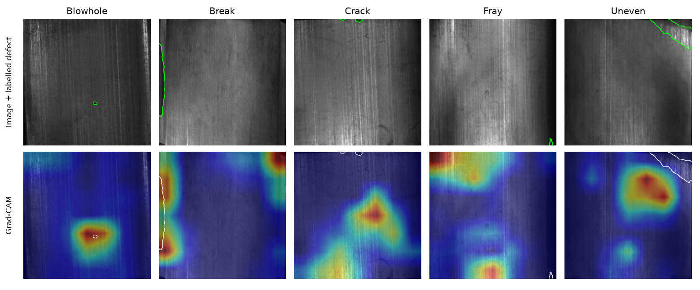

# Magnetic Tile Defect Inspection: Leakage-Free CNN, Grad-CAM Check and INT8 Edge Export


Classifies surface defects on magnetic tiles (the curved permanent magnets inside electric motors) into six classes: Blowhole, Break, Crack, Fray, Uneven or Free (no defect). A fine-tuned MobileNetV3-Small is compared with a classical baseline, its Grad-CAM heatmaps are measured against pixel-level defect masks instead of eyeballed, and it is exported to ONNX and quantized to mixed-precision INT8 for a CPU-only edge device.

The most important result is about the data, not the model: **the dataset photographs each tile up to six times under different lighting, so a random train/test split leaks.** This project groups those near-duplicates and splits by group.

## Results

All numbers are on the held-out test split: **192 images of 81 distinct tiles** (54 good tiles, and 9 Blowhole, 8 Break, 6 Uneven, 4 Crack and 3 Fray tiles). Brackets are 95% intervals from a bootstrap that resamples whole tiles, because views of one tile are not independent.

### 1. A random split overstates the model

| Split | Test macro-F1 | Defects caught |
|---|---|---|
| Random image split (leaky) | 0.950 | 92.9% |
| **Split by tile (this project)** | **0.747** | **75.0%** |

Same model, same training. Under the random split, **72% of test images have another view of the same tile in training.** Scored separately, the leaky model catches 98% of defects on those twinned images (42 of 43) but only 77% on tiles it has never seen (10 of 13), almost exactly what the honest split reports. The random split's extra 20 points of macro-F1 come from recognising tiles, not from detecting defects.

### 2. Model comparison

| Model | Test macro-F1 | Accuracy | Defect PR-AUC | Defects caught | False alarms on good tiles |
|---|---|---|---|---|---|
| Logistic regression on hand-made image features | 0.480 [0.38, 0.62] | 74.5% | 0.628 | 34 / 56 | 23 / 136 |
| **MobileNetV3-Small, ImageNet-pretrained, fine-tuned** | **0.747 [0.62, 0.94]** | **88.0%** | **0.948** | 42 / 56 | 4 / 136 |

Validation macro-F1 was 0.961 for MobileNetV3, against 0.747 on test. That gap is not test overfitting (the test split was never used for a decision). It is what 3 Fray tiles and 4 Crack tiles do to a per-class average: one tile moves Fray recall by 33 points. The bootstrap interval, 0.62 to 0.94, is the honest summary.



Most mistakes are defects called "Free" (5 Blowhole, 6 Uneven, 2 Fray views), so the argmax decision is the wrong one for a production line.

### 3. A defect alarm set for the line, not for accuracy

An alarm fires when P(Free) is low enough: `1 - P(Free) >= threshold`. The threshold is the highest one that still catches 98% of defects on **validation**, then applied unchanged to test.

| Model | Threshold | Validation: defects caught | Test: defects caught | Test: false alarms |
|---|---|---|---|---|
| Logistic regression | 0.003 | 56 / 57 | 51 / 56 (91%) | 116 / 136 (85%) |
| **MobileNetV3-Small** | **0.266** | 56 / 57 | **53 / 56 (95%) [90%, 100%]** | **19 / 136 (14%)** |

At the same safety target the baseline has to flag 85% of good tiles; the CNN flags 14%. That difference, not macro-F1, is what decides whether automatic inspection saves any manual work.

### 4. Does Grad-CAM look at the defect?

| Measure (56 test defect images) | MobileNetV3 | Random pixel | Image centre |
|---|---|---|---|
| Hottest pixel on the labelled defect (8 px tolerance) | **60.7%** | 11.7% | 5.4% |
| Share of heatmap mass on the defect | **18.9%** | 8.8% (mask area) | |

By class: Break 75%, Crack 62%, Uneven 60%, Blowhole 53%, Fray 50% (4 images). Grad-CAM points at the defect five times more often than chance, but in 4 cases out of 10 the hottest region is elsewhere, so a heatmap is evidence for a reviewer, not proof.



One test image per defect class, the first in the split, not hand-picked: Blowhole and Break are hits; Crack, Fray and Uneven are misses.

### 5. Edge export

One CPU thread, batch size one, 300 runs per model, interleaved so background load hits every variant equally.

| Variant | File | Median latency | p90 | Test macro-F1 | Accuracy | Same answer as PyTorch |
|---|---|---|---|---|---|---|
| PyTorch FP32 | 6.23 MB | 40.0 ms | 64.2 ms | 0.747 | 88.0% | 100% |
| ONNX Runtime FP32 | 6.35 MB | **10.7 ms** | 20.7 ms | 0.747 | 88.0% | 100% (max logit difference 2e-5) |
| ONNX INT8, every op quantized | 1.80 MB | 17.7 ms | 29.6 ms | 0.056 | 9.4% | 9.9% |
| **ONNX INT8, mixed precision (shipped)** | **1.79 MB** | 14.0 ms | 22.0 ms | **0.750** | **89.1%** | **96.9%** |

- **ONNX Runtime is 3.7× faster than PyTorch** on the same CPU with identical outputs.
- **Naive INT8 destroys the model.** After BatchNorm is folded into the stem convolution, its outputs reach about ±130 while most channels stay below 1. INT8 uses one scale per activation tensor, so a step of about 1.0 rounds those channels to zero. Quantizing *only the first convolution* already drops agreement with FP32 to 1%.
- **The fix is mixed precision, chosen on validation.** Only Conv and Gemm run in INT8 (the cheap element-wise ops stay FP32), and a sensitivity search quantizes one layer at a time, ranks the damage, and keeps the worst layers in FP32 until INT8 agrees with FP32 on 98% of validation images. It took **6 of 54 layers**, all in the first quarter of the network: the stem, the first depthwise convolution and four early 1×1 and depthwise layers. The result is **3.5× smaller** with the same test accuracy.
- **INT8 was not faster on this laptop.** The Intel Core i5-6300U (Skylake) has no VNNI instructions, so ONNX Runtime's INT8 kernels lose to its FP32 ones. The size reduction is real everywhere; the speed-up needs VNNI on x86 or dot-product instructions on ARM. Measured on battery with other apps running: an earlier run on an idle machine gave 6.3 ms for ONNX FP32, so read the absolute numbers as an upper bound and the ratios as the result.

## What did not work

- **A small CNN trained from scratch.** Under the same 15-minute CPU budget it never got past predicting "Free" for every tile. A memorisation test on 16 training images found why: in training mode the loss fell to 0.003, but in evaluation mode it was right on only 4 of the same 16 images. BatchNorm's running statistics lagged behind weights that were changing fast; GroupNorm removed the mismatch but learned far too slowly for this budget. It was replaced by the classical baseline above, which answers the same question (what does the pretrained CNN buy?) without that failure mode.
- **Post-training INT8 with every op quantized**, across seven settings (per-tensor and per-channel, reduced range, percentile calibration, U8U8, Conv-only, both PyTorch ONNX exporters). Every variant agreed with FP32 on about 10% of images. The fix above came from bisecting which layers broke.

## Why these choices

- **Split by tile, not by image.** File prefixes `exp1` to `exp6` are six lighting setups, and the same tile appears under each (for example `Blowhole/exp1_num_6984` ... `exp6_num_7102`). Images are grouped by visual similarity (64×64 thumbnails with correlation above 0.95 and sizes within 10 px), giving 612 groups, and whole groups go to one split with `StratifiedGroupKFold`. Over-merging only makes the split stricter. The split is saved in [`data/splits.csv`](data/splits.csv) so anyone can audit it.
- **Macro-F1, not accuracy.** 71% of tiles are defect-free, so "always Free" is 71% accurate. Macro-F1 weighs the 32-image Fray class as much as the 952-image Free class. Model selection and early stopping use validation macro-F1; the test split is scored once.
- **Defect recall as the line-side metric.** A missed defect ships a bad magnet; a false alarm costs a manual re-check. The report shows both, separately from the six-class scores.
- **Imbalance handled gently.** Cross-entropy weighted by the square root of inverse class frequency, plus label smoothing 0.05. Full inverse weighting would multiply Fray's loss by about 30 and make training unstable on 24 training images.
- **Augmentation that matches the physics.** Flips and small rotations (tiles have no fixed orientation) and brightness/contrast jitter (lighting differs between setups). No colour jitter: the images are grayscale.
- **A classical baseline first.** Logistic regression on a 24×24 thumbnail, intensity and gradient histograms, with the same class weighting and its regularisation chosen on validation. It shows how much the pretrained CNN actually buys.
- **Confidence intervals by tile.** The test split has only 3 Fray tiles, so every headline number carries a 95% interval from a bootstrap that resamples tiles, stratified by class.
- **Grad-CAM measured, not admired.** For every test defect image: does the heatmap's hottest pixel land on the labelled defect (pointing game, 8 px tolerance at 224×224), and what share of the heat lies on it? Compared against pointing at a random pixel and always pointing at the image centre.
- **Edge numbers measured like an edge device runs.** One CPU thread, batch size one, warmed up, every variant timed round-robin on the same images. INT8 is calibrated on 200 training images, its layer choices are made on validation, and it is scored on the same test set as the original.

## Run it

Python 3.11+, CPU only.

```bash
python -m venv .venv
# Windows: .venv\Scripts\activate    Linux/macOS: source .venv/bin/activate
pip install torch torchvision --index-url https://download.pytorch.org/whl/cpu
pip install -r requirements.txt
python scripts/download_data.py      # 53 MB from the dataset's GitHub repository
python run_pipeline.py               # split, train, evaluate, export and benchmark (about 45 min on a laptop CPU)
python app.py                        # Gradio demo at http://127.0.0.1:7860 (local only)
pytest                               # 16 tests on synthetic tiles, no download needed
```

Individual steps:

```bash
python -m tiles.train --arch mobilenet_v3_small
python -m tiles.train --arch mobilenet_v3_small --split random   # leakage check only
python -m tiles.evaluate                                          # baseline, test metrics with intervals, alarm, Grad-CAM, leakage
python -m tiles.export                                            # ONNX FP32, INT8 sensitivity search, benchmark
python -m tiles.export --benchmark-only                           # re-time existing models only
```

Measured with Python 3.12, PyTorch 2.15 (CPU), ONNX Runtime 1.31 on an Intel Core i5-6300U laptop (2 cores, 4 threads). MobileNetV3 training took 16 minutes (18 epochs, stopped by the time budget).

The trained MobileNetV3 checkpoint and its mixed-precision INT8 ONNX model are included in `models/`, so `python app.py` works straight after installing dependencies (download the data too if you want the six test images as clickable examples). The demo classifies with the INT8 model, raises a defect alarm at the validation-chosen threshold rather than on the top class, and overlays Grad-CAM from the FP32 model.

## Project layout

```
tiles/data.py        image index, near-duplicate grouping, grouped and random splits, transforms
tiles/model.py       MobileNetV3-Small with a 6-class head
tiles/baseline.py    hand-made image features + logistic regression
tiles/train.py       training loop, class weights, early stopping on validation macro-F1
tiles/metrics.py     macro-F1, defect recall, alarm threshold, tile-level bootstrap intervals
tiles/gradcam.py     Grad-CAM, pointing game and heat-on-defect measures
tiles/evaluate.py    baseline, test metrics, alarm, confusion matrices, Grad-CAM and leakage checks
tiles/export.py      ONNX export, INT8 layer-sensitivity search, interleaved single-thread benchmark
app.py               Gradio demo: INT8 prediction plus Grad-CAM overlay
run_pipeline.py      reproduces every number in this README
data/splits.csv      the exact grouped split used
reports/             metrics.json, edge_benchmark.json, training histories, figures
tests/               data, grouping, model, Grad-CAM, ONNX parity and quantization tests
```

## Data

[Magnetic Tile Defect dataset](https://github.com/abin24/Magnetic-tile-defect-datasets.) from Huang, Qiu and Yuan, "Surface defect saliency of magnetic tile", *The Visual Computer* (2020): 1,344 grayscale regions of interest cropped from magnetic tile photographs, with a pixel mask for every defect.

| Class | Images |
|---|---|
| Free (no defect) | 952 |
| Blowhole | 115 |
| Break | 85 |
| Uneven | 103 |
| Crack | 57 |
| Fray | 32 |

The repository publishes no license, so the images are not redistributed here; `scripts/download_data.py` fetches them from the original source. Use them for research and learning, and cite the paper.

## Limitations

- 81 test tiles, only 3 to 9 per defect class. Per-class numbers are anecdotes; read the bootstrap intervals.
- Near-duplicate grouping uses image similarity, not ground-truth tile IDs (the dataset has none). It is deliberately strict, but a pair of views below the 0.95 correlation threshold could still be split.
- Training stopped on its 15-minute CPU budget at epoch 18 (best validation epoch 13); more epochs or a GPU might move the numbers.
- Grad-CAM explains the FP32 model; the shipped INT8 model gives the same top class on 96.9% of test images.
- Images are cropped regions of interest under laboratory lighting. A real line would need its own validation set before trusting these alarm rates.

## License

Code: MIT. Dataset: see above.
